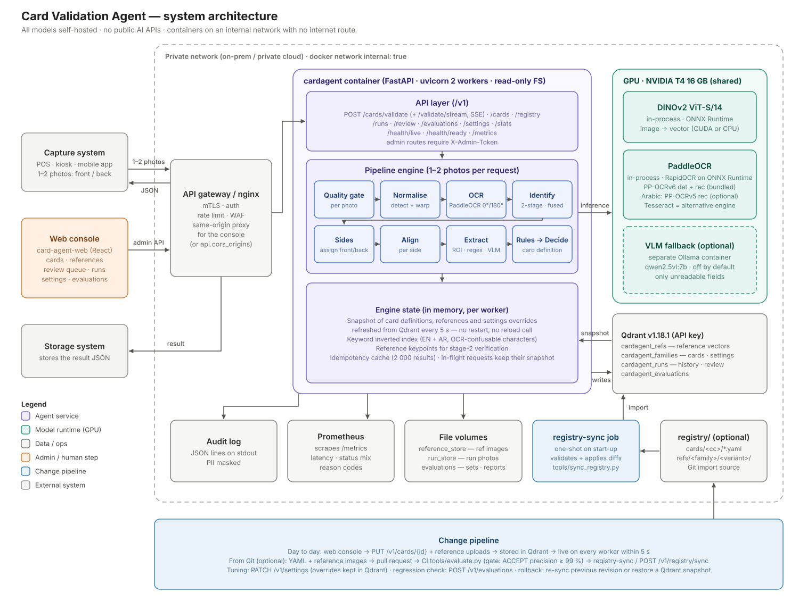
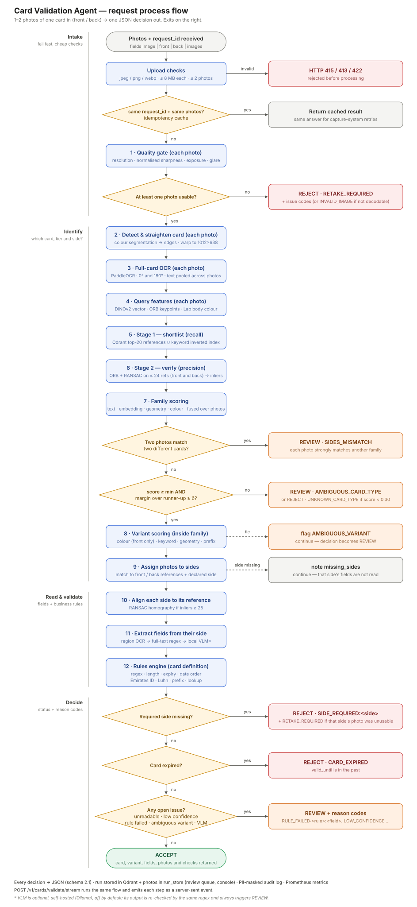

# Diagrams

Both diagrams are SVG files (they render on GitHub and in any browser) and are generated from code,
so they stay editable: change `tools/make_diagrams.py`, then run

```
python tools/make_diagrams.py docs/diagrams
```

Revalidated against `feature/paddleocr` (two-sided cards, PaddleOCR, Qdrant-only storage).

## System architecture
What sits inside the private network:
- the API gateway / nginx
- the `cardagent` container: the `/v1` API, the pipeline engine, and engine state refreshed from Qdrant every 5 s
- the in-process DINOv2 and PaddleOCR models, plus the optional Ollama VLM container
- Qdrant and its four collections
- the file volumes, the registry-sync job, the optional `registry/` Git import, and the web console

It also shows the change pipeline: the console/API path day to day, Git + `evaluate.py` as the optional path.



## Request process flow
What happens to 1–2 photos of one card:
- intake checks and a per-photo quality gate
- two-stage identification fused across photos (with the `SIDES_MISMATCH` exit)
- side assignment
- per-side alignment and field extraction
- rules
- the decision: `SIDE_REQUIRED` → `CARD_EXPIRED` → REVIEW reasons → ACCEPT

Early exits are on the right.

Note: a rule's `critical` flag only colours the trace step. In the decision, only an expired card
rejects; every other failed rule leads to REVIEW `RULE_FAILED:<rule>:<field>`.


